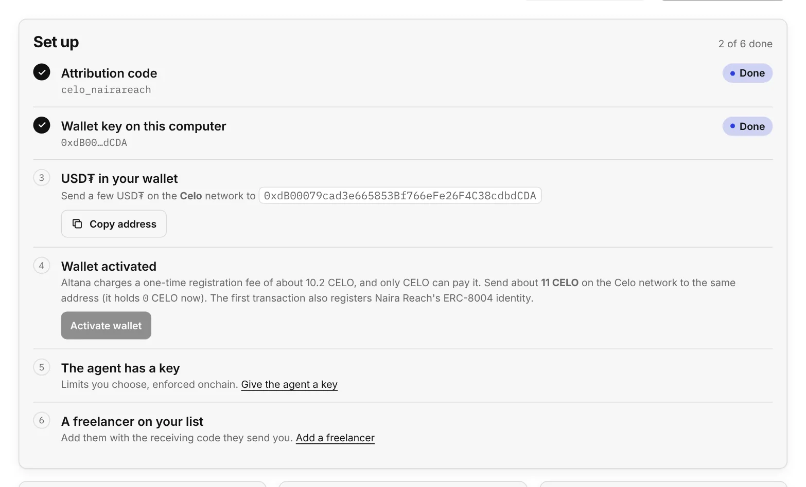
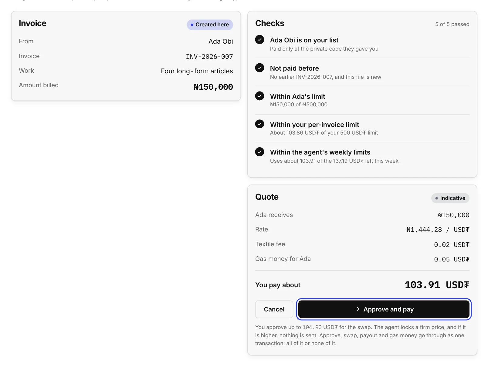
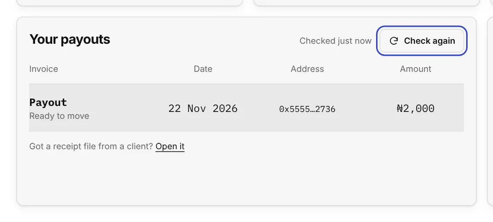

# Naira Reach

**Paid from anywhere. Privately. Only to you.**

Naira Reach is an AI agent that pays a Nigerian freelancer's invoice in naira. The client pays in USD₮, the freelancer receives the exact cNGN they billed at an address only they can open, and the whole payment happens on Celo mainnet, within limits the client sets and can take back at any time.

Built for **Agents Open for Business** (Loops House, on Celo), entering the **Stablecoin Corridors** (Textile FX) and **Altana Agent Wallets** tracks.

<table>
<tr>
<td align="center" width="25%"><b>Live site</b><br><a href="https://nairareach.myacxt.site">nairareach.myacxt.site</a></td>
<td align="center" width="25%"><b>For judges</b><br><a href="JUDGES.md">JUDGES.md</a>: what to check, in order</td>
<td align="center" width="25%"><b>Demo video</b><br>Coming soon</td>
<td align="center" width="25%"><b>First payment</b><br><a href="https://celoscan.io/tx/0x5131fd5b5d14012e6a97a86a6cb4608264a52eebc1f67bf1e47a7a814d410aea">₦2,000 on Celo</a></td>
</tr>
<tr>
<td align="center"><b>Agent identity</b><br><a href="https://8004scan.io/agents/celo/10090">ERC-8004 #10090</a></td>
<td align="center"><b>Client wallet</b><br><a href="https://celoscan.io/address/0xB2441B175d620A3Fd5CDef28fA1c6957e6224431">0xB244…4431</a></td>
<td align="center"><b>Agent's key</b><br><a href="https://explorer.altana.network/account/0xB2441B175d620A3Fd5CDef28fA1c6957e6224431">Altana explorer</a></td>
<td align="center"><b>Tests</b><br><a href="#tests">191 passing</a></td>
</tr>
</table>

---

## Contents

1. [The problem](#the-problem)
2. [What Naira Reach does](#what-naira-reach-does)
3. [Results on Celo mainnet](#results-on-celo-mainnet)
4. [How it fits the tracks](#how-it-fits-the-tracks)
5. [How it works](#how-it-works)
6. [Privacy](#privacy)
7. [Use it on the website](#use-it-on-the-website)
8. [Run it on your own computer](#run-it-on-your-own-computer)
9. [Tests](#tests)
10. [Honest limits](#honest-limits)
11. [What's next](#whats-next)
12. [Reference](#reference)
13. [Credits and license](#credits-and-license)

---

## The problem

A Nigerian freelancer paid from abroad loses at every step:

- **Slow and uncertain.** Bank transfers take days, and the rate moves before the money lands, so they rarely get what they billed.
- **Easy to defraud.** A fake invoice with swapped payment details sends the money to someone else, and the client only finds out when the freelancer asks where their money is.
- **Public, once crypto is involved.** Being paid in stablecoins fixes speed, but it creates a new problem: a public wallet that shows every client they have and every naira they earn, to anyone who looks.

## What Naira Reach does

The client gives the agent a limited key to their own wallet. The agent reads the invoice, checks it, gets a firm quote for the exact naira amount, converts USD₮ to cNGN, and pays it to a brand-new private address that only the freelancer can open. The freelancer's page finds the payout by itself.

### Three promises

| Promise | How it is kept |
|---|---|
| **In naira, exactly** | The agent asks Textile FX for an exact-output quote: "deliver exactly ₦150,000". The freelancer gets what they billed. The client sees the USD₮ cost before anything moves. |
| **Privately** | Every payout goes to a one-time address made from the freelancer's private receiving code (ERC-5564 stealth addresses). Outsiders can't link one payment to the next, or add up what a freelancer earns. Names, emails and bank details never go onchain. |
| **Only to you** | The agent never pays an address written on an invoice. It pays only the receiving code the client approved for that freelancer. A fake invoice has nothing to swap. |

### Who it is for

- **Clients abroad** who already pay in stablecoins (Web3 teams, agencies, startups) and want invoices settled in naira without handling the conversion themselves.
- **Nigerian freelancers** (writers, designers, developers) who want to be paid in naira, exactly what they billed, without publishing their income to the world.

### One website, two sides

[nairareach.myacxt.site](https://nairareach.myacxt.site) has a switch at the top left:

- **Send**, for the client. The agent runs in the client's own browser. Their wallet key is locked there with a password only they know.
- **Receive**, for the freelancer. Their receiving keys are made in their browser and never leave it. Payouts appear on their own.

Each side has a **Guide** link with every step, a picture of each screen, and the button to press outlined.

---

## Results on Celo mainnet

Everything below is live on Celo mainnet (chain 42220) and can be checked on the linked explorers.

| What | Result |
|---|---|
| **Live website** | [nairareach.myacxt.site](https://nairareach.myacxt.site), Send and Receive on one site, hosted on Vercel |
| **Client wallet** | [`0xB2441B175d620A3Fd5CDef28fA1c6957e6224431`](https://celoscan.io/address/0xB2441B175d620A3Fd5CDef28fA1c6957e6224431), an Altana wallet (EIP-7702), activated |
| **ERC-8004 identity** | [Agent #10090, "Naira Reach"](https://8004scan.io/agents/celo/10090), registered by the wallet's first transaction and confirmed by the Loops House check |
| **The agent's key** | 10 USD₮ and ₦15,000 a week, for 14 days, four allowed calls. Listed in Altana's KeyStore: [the wallet's keys and permissions](https://explorer.altana.network/account/0xB2441B175d620A3Fd5CDef28fA1c6957e6224431) |
| **First payment** | ₦2,000 (test invoice TEST-002) for 1.388823 USD₮, at ₦1,440.07 per USD₮. Textile RFQ `rfq_vLcBoGXicFHjHMbv`. Approve, swap, private payout and gas money in **one atomic Altana intent**: [0x5131…0aea](https://celoscan.io/tx/0x5131fd5b5d14012e6a97a86a6cb4608264a52eebc1f67bf1e47a7a814d410aea) |
| **Where the money went** | 1.388546 USD₮ to Textile's maker plus 0.000277 USD₮ fee. Exactly 2,000 cNGN and 0.05 USD₮ of gas money to a fresh private address, [`0x2448…9828`](https://celoscan.io/address/0x244863ede6688da2a60d2f77fd4ed9ee75729828). Nothing left behind: the wallet holds 0 cNGN and its leftover allowance to Textile is 0 |
| **Automatic delivery** | The standard ERC-5564 announcer, deployed on Celo by Naira Reach at the same address it has on other chains: [`0x5564…5564`](https://celoscan.io/address/0x55649E01B5Df198D18D95b5cc5051630cfD45564). The ₦2,000 was announced in [0x14b4…5fc9](https://celoscan.io/tx/0x14b4850f552900f143b26ecc45e35721f5eeed7e1ab91ab3a50ca2633bed5fc9), and the Receive page found it with nothing but the receiver's own keys |
| **Tagged payment from the agent wallet** | ₦2,000 (test invoice TEST-003), still signed by the agent's limited key as one atomic Altana intent, but **sent by the wallet itself** with the Loops House code as the last bytes of the transaction: [0xd540…7754](https://celoscan.io/tx/0xd54014be53c8034b73d4484f32096cb2b7870a8299c075836c99459dde4f7754). Its announcement went the same way: [0xa390…f96a](https://celoscan.io/tx/0xa390411fe01da15bc0b388d9b8a70a22ebc817a71ed43ef259e6674fd2eff96a). Loops House's own check now shows **"Tag seen on-chain"** for this entry |
| **Attribution** | Every call inside a payment carries the Loops House code (ERC-8021), and so does the outer transaction now that the wallet sends it. The first payment (TEST-002) went through Altana's relayer, so it isn't counted; every payment since is |
| **Tests** | 191 passing, no network needed. See [Tests](#tests) |
| **Live checks** | Textile's live preview gave a flat ₦1,442.52 per USD₮ from ₦1,000 to ₦20,000,000, with a 0.02% fee, answering in 0.3 to 1.1 seconds. A ₦150,000 quote didn't move at all over 66 seconds of sampling |

---

## How it fits the tracks

### Stablecoin Corridors (Textile FX)

| Requirement | How Naira Reach meets it | Proof |
|---|---|---|
| A tagged Textile FX conversion on Celo mainnet, in a listed corridor, used in the product flow | Every invoice is settled by a USD₮ → cNGN conversion through Textile FX. The conversion is the payment itself | [First payment](https://celoscan.io/tx/0x5131fd5b5d14012e6a97a86a6cb4608264a52eebc1f67bf1e47a7a814d410aea) |
| A local-stablecoin payment that reaches a recipient outside the team | The cNGN goes to the freelancer at a brand-new address nobody funded beforehand | First payment was a team test; a real freelancer payment is next |
| An ERC-8004 identity | The wallet registers as "Naira Reach" in the ERC-8004 registry on its first action | [Agent #10090](https://8004scan.io/agents/celo/10090) |
| A named user with a real job done | A real client paying a real freelancer for real work | Coming with the real payment |

### Altana Agent Wallets

| Requirement | How Naira Reach meets it | Proof |
|---|---|---|
| The agent acts from a non-custodial Altana wallet | The client's own Altana wallet holds the funds. The client's key stays locked in the client's browser | [Wallet](https://celoscan.io/address/0xB2441B175d620A3Fd5CDef28fA1c6957e6224431) |
| Under a person-granted session key | The client gives the key on **Agent access** (or `session grant`) | [Keys and permissions](https://explorer.altana.network/account/0xB2441B175d620A3Fd5CDef28fA1c6957e6224431) |
| With a spend cap, a contract allowlist and an expiry | Weekly USD₮ and cNGN caps, a short list of allowed calls, and an expiry of up to 90 days, all enforced onchain | Same |
| Revocable | **Revoke the agent's key** (or `session revoke`), effective from the next block | `src/altana.ts` |

---

## How it works

### The client stays in control

The money never leaves the client's own Altana wallet until the moment of payment. The agent holds a **session key**, not the wallet. That key is limited onchain:

- **What it may call:** approve USD₮, swap on the Textile FX reactor, transfer cNGN, transfer a few cents of USD₮ as gas money, and announce the payout. The wallet contract refuses any other call.
- **How much it may spend:** a weekly cap on USD₮ and a weekly cap on cNGN.
- **For how long:** the key expires by itself (7 days by default, 90 at most).
- **Revocable:** one button takes it back, effective from the next block.

All the steps for one invoice run as **one atomic intent**. Either the approval, swap, payout and gas money all happen, or none of them do. A failed swap can never leave half a payment behind.

### What it catches

Before any money moves, the agent runs these checks. A failed check is a **hold**: nothing is sent, and the client decides.

| Check | Example of what it stops |
|---|---|
| Is the freelancer on the approved list? | An invoice from someone the client never hired |
| Was this invoice number already paid? | The same invoice sent twice |
| Was this exact file already paid? | A renamed copy of an old invoice |
| Is the amount within this freelancer's limit? | A ₦2,000,000 invoice from someone who bills ₦150,000 |
| Does it match the agreed amount, if there is one? | A retainer quietly raised |
| Is the dollar cost within the client's ceiling? | A bad rate or a typo in the amount |
| Is it big enough for Textile? | An invoice under about ₦1,440, which Textile would refuse |
| Does the quote point at the real Textile reactor, on Celo, and pay the full amount? | A tampered, short or expired quote |
| Did the price move more than the client approved? | Slippage: the client approves up to 1% above the price shown; a higher firm price sends nothing |
| Does the invoice contain a wallet address? | Flagged and ignored, every time |

### How a payment flows

```
Freelancer, once:   Receive → Create my receiving code → shares st:celo:0x… with the client
Client, once:       Send → Create my wallet        → wallet locked in the browser
                    Activate wallet                 → Altana wallet + ERC-8004 identity
                    Give the agent a key            → capped, expiring, revocable
                    Add a freelancer                → approves the freelancer's code

Agent, per invoice: Pay an invoice
  1. read the invoice                (the AI reader sees redacted text only)
  2. run the checks                  (hold and stop if anything is off)
  3. derive a fresh private address  (from the freelancer's code, never from the invoice)
  4. lock a Textile quote            (exact naira out, USD₮ cost shown, within the approved price)
  5. one atomic intent, signed by the agent's key, every call tagged:
       approve USD₮ → swap USD₮→cNGN → send cNGN → send gas money → announce
     sent by the wallet itself, with the tag at the end, so it counts as the agent wallet's
  6. report the fill to Textile, check the tags, keep a receipt

Freelancer, any time: Receive → Payouts
  the page finds the payout from the announcement, with their own keys, in their own browser,
  and moves the naira, paying the network fee in the USD₮ that came with it
```

### What Naira Reach is made of

| Part | What it does |
|---|---|
| Invoice reader | Reads a JSON invoice directly, or a plain-text invoice with Claude. Contact and bank details are stripped before the text leaves the machine, and the model can only answer through a fixed form. |
| Checks and ledger | The approved freelancer list, the record of paid invoices, and the holds above. |
| Textile FX client | Requests a firm, exact-output USD₮ → cNGN quote and reports the fill. Works without an API key by proving control of the paying wallet. |
| Altana wallet and session | Sets up the client's wallet, grants and revokes the agent's limited key, and sends each payment as one atomic intent. |
| Private payouts | Makes the freelancer's receiving code, derives a fresh address per invoice, and announces each payout on Celo (ERC-5564). |
| Attribution | Adds the Loops House code to every call (ERC-8021) and checks it is readable onchain. |
| Receipts | One file per payment for the client's records: amount, rate, transaction links and the invoice fingerprint. No personal details. |
| Website | One site with two sides. **Send** runs the agent in the client's browser, its keys locked with the client's password. **Receive** runs entirely in the freelancer's browser. The only server part is a small relay that passes price requests to Textile. It holds no keys and keeps no records. |

---

## Privacy

<table>
<tr>
<th width="50%">For the receiver (the freelancer)</th>
<th width="50%">For the sender (the client)</th>
</tr>
<tr>
<td valign="top">
<ul>
<li><b>A code, not an address.</b> The freelancer shares a receiving code (<code>st:celo:0x…</code>). It can't be looked up on Celo, so nobody can use it to see their money.</li>
<li><b>A fresh address every time.</b> Each payout lands at a brand-new address made from that code. Nobody can link two payments to the same person or add up what they earn.</li>
<li><b>Found in their own browser.</b> Their Receive page finds each payout from a public announcement that only their keys can recognise. The keys never leave the browser and nothing is sent to Naira Reach.</li>
<li><b>Moving the money needs no gas token.</b> A few cents of USD₮ comes with every payout, so moving the naira doesn't reveal another wallet that bought CELO.</li>
</ul>
</td>
<td valign="top">
<ul>
<li><b>The client's keys stay with the client.</b> The wallet key and the agent's key are locked in the client's browser with a password only they know (PBKDF2-SHA256 with 600,000 rounds, then AES-256-GCM). Naira Reach never sees a key or the password.</li>
<li><b>The agent holds a limited key, not the wallet.</b> It may only approve, swap, pay and announce, within weekly caps, and the client can take it back at any time.</li>
<li><b>No personal details go onchain.</b> No names, emails or bank details in payments, announcements or receipts.</li>
<li><b>The AI never sees personal details.</b> Emails, phone numbers, account numbers and wallet addresses are removed from an invoice before the AI reader sees it.</li>
</ul>
</td>
</tr>
</table>

### Who can see what

| Who | What they can see |
|---|---|
| Anyone looking at the chain | That the client's wallet paid ₦2,000 to a new address. Not who owns that address, and not that it belongs to the same person as last month's payout. |
| Naira Reach's server | Only the price requests passed to Textile: amounts and the paying wallet. No keys, passwords, invoices or names. |
| The AI invoice reader | The invoice text with personal and payment details removed. |
| An accountant or tax office | Whatever the freelancer chooses to show. The receipt's fingerprint proves which invoice a payment settled, without publishing the invoice. |

### How the private address works

The receiving code holds two public keys: a **spending key** and a **viewing key** (ERC-5564, scheme 1).

1. For each invoice, the agent combines a one-time random key with the freelancer's code. The result is a brand-new address nobody has used before.
2. In the same payment, it posts an **announcement** on Celo. Only the freelancer's viewing key can tell it's theirs.
3. The freelancer's Receive page checks the announcements with their viewing key, lists the matches, and opens each address with their spending key, all inside the browser.

Our addresses match ScopeLift's ERC-5564 reference library on 300 out of 300 test cases.

Naira Reach keeps a freelancer's income private from the public. It doesn't hide anything from the exchange they cash out with, and it isn't meant to.

---

## Use it on the website

Open [nairareach.myacxt.site](https://nairareach.myacxt.site). Choose **Send** or **Receive** at the top left. The **Guide** link in the left bar shows each step below with a picture.

### Send: the client's side

1. **Create your wallet.** Type your name if you like, then a password of at least 10 characters, twice, and press **Create my wallet**. Nobody can reset this password. Already set up in another browser? Use **Open your locked backup** instead.
2. **Follow the set-up list.** The Overview shows six steps, each with a tick or the next thing to do. When all six are ticked, the list disappears.

   
3. **Put USD₮ in your wallet.** Press **Copy address**, then send **USDT on the Celo network**: Tether's USD₮, contract `0x48065fbBE25f71C9282ddf5e1cD6D6A887483D5e`. Not cUSD or USDC, because Textile's naira pair on Celo is cNGN against USD₮.
4. **Add about 11 CELO, then press Activate wallet.** Altana charges a one-time fee to list a wallet in its public KeyStore, about 10.2 CELO, and only CELO can pay it. The same transaction registers the agent on ERC-8004.
5. **Give the agent a key.** On **Agent access**, set USD₮ per week, naira per week, and how many days the key lasts. Each new key costs another 10.2 CELO in KeyStore fees, so keep that much in the wallet first.
6. **Look after the key.** Agent access shows what's left this week and when the key expires. **Re-sign Textile proof** renews the proof Textile needs (about every 11 hours; the agent also renews it by itself before paying). **Revoke the agent's key** takes it back.
7. **Keep your wallet safe.** **Download locked backup** saves your wallet, encrypted with your password. **Lock Send** when you step away.
8. **Turn on automatic delivery**, if the Overview shows that card. It announces any earlier payouts so they appear on the freelancer's side. From then on, every payment announces itself.
9. **Add a freelancer.** On **Freelancers**, enter their name as it appears on their invoices, any other names, a limit per invoice or a fixed amount, and the receiving code they made on the Receive side. Check the code with them on a call before saving.
10. **Create the invoice.** On **Pay an invoice**, pick the freelancer, type the naira amount and press **Check and price**. The invoice number is filled in for you; no file is needed. If your freelancer sent an invoice file, **Or use an invoice file** takes it instead, and ignores any wallet address written on it.
11. **Check and pay.** The agent shows every check and prices the exact naira billed. Press **Approve and pay**: you approve up to 1% above the price shown, and if the firm price is higher, nothing is sent.

    
12. **Paid and delivered.** The naira is at a fresh private address, and it's already on the freelancer's Receive page. **Download receipt** keeps a copy for your records.
13. **Take money out, if you need to.** **Withdraw** under the wallet balance on the Overview sends USD₮ or leftover CELO to any Celo address: an exchange's deposit address or another wallet. **Max** leaves a few cents for the fee. It is signed with your own wallet key, never the agent's, and refuses the zero address and token contracts.

### Receive: the freelancer's side

This side runs entirely in the freelancer's browser. No wallet or money is needed to start.

1. **Create my receiving code.** The keys are made in the browser and sent nowhere.
2. **Back up my keys.** This downloads a file. Whoever has it can open the payouts, so it stays private. **Restore a backup** brings the keys into another browser.
3. **Copy code** and send it to the client. It isn't a wallet address, and nobody can use it to look up what you've been paid.
4. **Payouts arrive by themselves.** **Payouts** checks Celo's announcements every time it opens; **Check again** looks for new ones.

   
5. **Move naira.** Click a payout, paste your own wallet or an exchange's cNGN deposit address on Celo, then press **Move naira**. The network fee comes out of the 0.05 USD₮ that arrived with the payout.
6. **Cash out.** **How to cash out** on Payouts lists the steps: move the cNGN to an exchange that takes cNGN on Celo, sell it for naira, and withdraw to your bank.

### What setting up cost us

| Step | Cost |
|---|---|
| Activating the wallet | 10.2 CELO (Altana's one-time KeyStore fee, about 55 cents when we did it) and about 0.03 USD₮ in transaction fees |
| Giving the agent a key | 10.2 CELO (KeyStore fee for the key) and a few cents of USD₮ |
| Each payment | The swap price plus Textile's fee (0.02%), 0.05 USD₮ of gas money for the freelancer, Altana's fee (0.008864 USD₮ on the first payment, 0.019557 on the second) and, now that the wallet sends the payment itself, the network fee (about 0.006 USD₮), all in USD₮ |

CELO is only needed for those two registrations. Everything else is paid in USD₮.

---

## Run it on your own computer

The same agent runs from a terminal, either as the website on your own computer or as commands. You need Node.js 22.18 or newer. Naira Reach runs on Node's built-in TypeScript support, so there is no build step.

### Install

```bash
git clone https://github.com/Mhiah/Naira-Reach.git
cd Naira-Reach
npm install --omit=dev
cp .env.example .env
```

Fill in `.env`. At minimum: `ATTRIBUTION_CODE`. A Textile API key is optional: without one, the paying wallet signs a short proof that it is the one asking for the quote.

On Windows PowerShell, type `npm.cmd` where this README says `npm`, or run commands directly with `node src/cli.ts <command>`.

### The website, on this computer

```bash
npm run app
```

Open http://localhost:8787 and keep the terminal open. Here the agent runs in the terminal with the keys from `.env`. The site only listens on this computer and checks where every request comes from; each run has its own key that only the page it serves knows.

### The command line

```bash
npm run reach -- check                                    # what is set up, and the next step
npm run reach -- freelancer keys                          # freelancer: make a receiving code
npm run reach -- wallet new-key                           # client: make the wallet key, saved in .env, never shown
npm run reach -- wallet setup                             # client: activate the Altana wallet, register ERC-8004
npm run reach -- session grant --usdt-per-week 200 --cngn-per-week 300000 --days 7
npm run reach -- freelancer add --id ada --name "Ada Obi" --meta st:celo:0x… --max 500000
npm run reach -- pay examples/invoice.json --dry-run      # price and check it, send nothing
npm run reach -- pay examples/invoice.json                # pay for real
npm run reach -- freelancer claim receipts/INV-….json --to 0xYourWalletOrExchangeDeposit
npm run reach -- session revoke                           # take the agent's key back
```

A dry run reads and checks the invoice, gets an indicative price from Textile's preview, and picks a fresh payout address. It reserves nothing, sends nothing, and needs no wallet. To see the AI reader and the fraud flag together, try `examples/invoice.txt`: it has a wallet address written on it, which the agent flags and ignores.

### Host your own copy

The `web/` folder is the whole website, including the Textile relay in `web/api/`. Import the repo on Vercel with `web` as the root directory. After changing anything in `src/browser/`, run `npm run build:web` to rebuild `web/vendor/`.

---

## Tests

```bash
npm install
npm test
```

**191 tests in 14 files, all passing, with no network needed.** They cover:

| Area | What is checked |
|---|---|
| Money | Every call the agent builds, decoded byte by byte. Exact kobo amounts. Duplicate payments refused |
| Quotes | 13 ways a quote can lie (wrong reactor, wrong chain, short payout, zero amounts, unreadable expiry, expired) all refused |
| Slippage | A firm price above what the client approved sends nothing, and holds can't override it |
| Private addresses | Our ERC-5564 addresses match ScopeLift's reference library, 300 out of 300 |
| Delivery | Announcements built correctly, the standard announcer address, and finding payouts from announcements, including junk logs and a busy RPC. A fake announcement claiming money that never arrived shows ₦0 |
| Moving a payout | The freelancer's transaction signed against a simulated Celo node, decoded, and its signer recovered. Refuses the zero address and token contracts |
| Attribution | Tags byte-identical to the official ERC-8021 encoder. The wallet sending its own Altana payment: the signed intent encoded exactly as Altana's relayer encodes it, sent from the wallet with the tag last, checked for free before sending |
| Holds | Every check in [What it catches](#what-it-catches) |
| Invoices | Redaction before the AI reader (emails, phones and account numbers however they're written, IBANs, wallet addresses), strict amounts (no booleans, hex or exponents), size limits |
| Withdrawing | The client's own transfer signed against a simulated Celo node and decoded: right amount and address, USD₮ fee and tag, plain CELO. What Max leaves for the fee. Refuses the zero address, the wallet itself, token contracts and bad amounts, and needs the client's own key |
| Keys | The password vault (wrong password, tampered file), the browser's key handling |
| Website | The local server's protections, the Textile relay's allowlist and limits |
| Full flow | Pay from start to finish with a mocked Textile and wallet, including failures |
| End to end | One payment followed from the client's key limits to the freelancer's browser: every call is one the key allows, and the freelancer sees the exact amount, kobo included, at an address only their keys open |

`npm run typecheck` is clean, and `npm audit` reports no vulnerabilities.

---

## Honest limits

- **The wallet sends its own payments.** Loops House only counts a transaction sent by the agent wallet with the code at the end, and Altana's relayer normally sends the transaction. So the agent signs each payment with its limited key as before, and the wallet submits that signed payment to Altana's Orchestrator itself, tagged (`src/selfsubmit.ts`). It checks for free first and sends nothing if the Orchestrator would refuse. Two costs follow: the wallet pays the network fee (a few US cents in USD₮), and Altana's fee in the intent is still paid. This needs the wallet's own key in the same browser, which the website has; the agent alone, without it, falls back to the relayer (`--relay` on the command line). Our first payment went through the relayer and isn't counted. We reported this to Altana as a product review: [altana-sdk #162](https://github.com/altananetwork/altana-sdk/issues/162).
- **Textile's smallest swap.** A firm quote must buy at least about ₦1,438 (roughly 1 USD₮). A ₦1,000 test invoice was refused by Textile before anything was sent; ₦2,000 went through. The agent now holds smaller invoices itself.
- **The first activation needs CELO.** Altana's one-time registration fee can only be paid in CELO, so a wallet holding only USD₮ can't be activated. About 11 CELO covers it, and each new agent key needs another 10.2.
- **cNGN isn't a Celo gas token.** That's why each payout carries a few cents of USD₮, so the freelancer can move the naira without buying CELO.
- **Announcements from the wallet, for now.** The agent's current key was given before announcing was added, so it isn't allowed to call the announcer. Until the next key, the client's wallet announces each payout right after the agent pays it. Every new key includes the announcer.
- **Cashing out.** Naira Reach doesn't pay into bank accounts. The freelancer moves the cNGN to an exchange that takes cNGN on Celo, sells it and withdraws to their bank. Busha and Quidax list cNGN; check in the exchange's app that it accepts cNGN deposits on Celo.
- **Keys live in the browser.** Clearing the browser's data removes them, which is why both sides ask for a backup. The freelancer's backup opens every payout, so it must stay private.
- **The weekly limit shown is counted from this browser's records.** The wallet enforces the real limit onchain. A payment made from somewhere else wouldn't show in the figure.
- **The agent's USD₮ transfer permission is broad.** It exists only to send gas money to the payout address, and the weekly cap limits it.
- **Plain-text invoices need a computer.** The online site reads `.json` invoices. The AI reader for `.txt` invoices needs `ANTHROPIC_API_KEY`, so it only works with `npm run app` or the command line.

---

## What's next

1. The first payment from a real client to a real freelancer, linked in Results
2. A new agent key, so the agent announces payouts itself
3. Recurring invoices: retainers paid on a schedule within the same key limits
4. More freelancers and clients using it

---

## Reference

### Commands

| Command | Who runs it | What it does |
|---|---|---|
| `npm run app` | Client | Opens the website at http://localhost:8787 with the agent behind it |
| `check` | Anyone | Shows what is set up and what is missing |
| `wallet new-key` | Client | Makes the wallet key and saves it in `.env` without showing it |
| `wallet setup` | Client | Creates and activates the Altana wallet; registers the ERC-8004 identity |
| `session grant [--usdt-per-week N] [--cngn-per-week N] [--days N]` | Client | Gives the agent a capped, expiring key |
| `session revoke` | Client | Removes the agent's key |
| `proof refresh` | Client | Re-signs Textile's wallet proof, needed about every 11 hours when there is no API key |
| `freelancer add --id --name --meta [--max] [--agreed] [--alias]` | Client | Approves a freelancer's receiving code |
| `freelancer list` | Client | Approved freelancers and totals paid |
| `pay <invoice> [--dry-run] [--direct] [--relay] [--approve-holds]` | Agent | Settles an invoice. `--dry-run` prices it with Textile's preview and sends nothing. With the wallet's key in `.env`, the wallet sends the payment itself; `--relay` leaves it to Altana's relayer |
| `freelancer keys` | Freelancer | Makes the private receiving code |
| `freelancer claim <receipt> --to 0x…` | Freelancer | Moves a payout onward |
| `verify <txHash>` | Anyone | Checks the attribution tag on a transaction |

### Settings (`.env`, command line and local website only)

| Variable | Needed for | Notes |
|---|---|---|
| `ATTRIBUTION_CODE` | Everything that sends | The code from Loops House enrollment |
| `TEXTILE_API_KEY` | Optional | Textile partner key. Without it, quotes are proven with a wallet signature |
| `CLIENT_ADMIN_PRIVATE_KEY` | Client commands | Stays on the client's device |
| `ANTHROPIC_API_KEY` | Plain-text invoices | Optional |
| `MAX_INVOICE_USDT` | Paying | Per-invoice dollar ceiling, default 500 |
| `GAS_TOP_UP_USDT` | Paying | Gas money per payout, default 0.05 |
| `CELO_RPC_URL` | Everything | Defaults to the public Celo RPC |
| `STEALTH_ANNOUNCER_ADDRESS` | Optional | A different ERC-5564 announcer. Default: the standard one, `0x5564…5564` |
| `CLIENT_NAME` | Optional | First name the website greets the client with |
| `NAIRA_REACH_PORT` | Optional | Port for the website, default 8787 |
| `DIRECT_WALLET_PRIVATE_KEY` | `--direct` only | Optional. Without it, `--direct` sends from the client's own wallet key, the same address as the Altana wallet |

### Invoice format

```json
{
  "invoiceId": "INV-2026-014",
  "freelancer": "ada",
  "amountNgn": 150000,
  "description": "Four long-form articles",
  "issuedAt": "2026-11-21"
}
```

`freelancer` matches the approved list by id, name or alias. `amountNgn` is naira, up to ₦1,000,000,000, with kobo allowed. Any other fields, including payment details, are ignored.

### Contracts and tokens (Celo mainnet, chain 42220)

| Name | Address |
|---|---|
| USD₮ | `0x48065fbBE25f71C9282ddf5e1cD6D6A887483D5e` |
| cNGN | `0xF6829D7393dAe24509eb1E52eE8e572e2E271a4f` |
| Textile FX LimitOrderReactor | `0xa9AA0a64769cBed4d3B1Ceb4Df01CdE915C235b3` |
| USD₮ fee currency (for gas) | `0x0E2A3e05bc9A16F5292A6170456A710cb89C6f72` |
| ERC-8004 identity registry | `0x8004A169FB4a3325136EB29fA0ceB6D2e539a432` |
| ERC-5564 announcer (standard address, same as other chains) | `0x55649E01B5Df198D18D95b5cc5051630cfD45564` |

Sources: the Textile FX address book, Celo's fee currency list, the Altana SDK, and ScopeLift's ERC-5564 deployment.

### Files

| Path | What it holds |
|---|---|
| `src/agent.ts` | The agent itself, shared by the website (in the browser or on a computer) |
| `src/pay.ts` | The payment flow, start to finish, and its holds |
| `src/invoice.ts` | Invoice reading, redaction, strict amounts and fingerprints |
| `src/checks.ts` | Approved freelancers, the ledger and the holds |
| `src/textile.ts` | Textile FX RFQ client and quote checks |
| `src/proof.ts` | Textile's keyless wallet proof |
| `src/altana.ts` | Client wallet and the agent's session key |
| `src/executor.ts` | Sending through Altana (atomic) or a plain wallet |
| `src/selfsubmit.ts` | The wallet sending its own signed Altana payment, tagged, so Loops House counts it |
| `src/stealth.ts` | Private payout addresses (ERC-5564 scheme 1) |
| `src/announcer.ts` | ERC-5564 announcements and the standard announcer |
| `src/move.ts` | Moving a payout, shared by the command line and the website |
| `src/withdraw.ts` | The client taking USD₮ or CELO out of their own wallet |
| `src/claim.ts` | The freelancer's claim from the command line |
| `src/tag.ts` | ERC-8021 attribution tags |
| `src/vault.ts` | The password vault (PBKDF2 + AES-256-GCM) |
| `src/browser/send.ts`, `src/browser/vaultstore.ts` | The Send side in the browser: the agent and the locked wallet, bundled into `web/vendor/send.js` |
| `src/browser/receive.ts` | The Receive side: keys, finding payouts and moving them, bundled into `web/vendor/receive.js` |
| `src/web.ts`, `src/server.ts` | The website on a computer (`npm run app`) and its protections |
| `src/cli.ts` | The command line |
| `web/` | The website: one page, plain JavaScript |
| `web/api/textile.mjs` | The Textile price relay, the site's only server part |
| `web/guide.js`, `web/guide/` | The Send and Receive guides and their pictures |
| `test/` | Tests |

On a computer, local state lives in `.naira-reach/` and receipts in `receipts/`. Both are gitignored.

---

## Credits and license

Built by Mhiah for Agents Open for Business.

Built on Celo, Textile FX for the conversion, Altana for the agent wallet, cNGN by WrappedCBDC, ERC-5564 stealth addresses (with ScopeLift's announcer), ERC-8004 agent identity, and ERC-8021 attribution.

MIT License.
