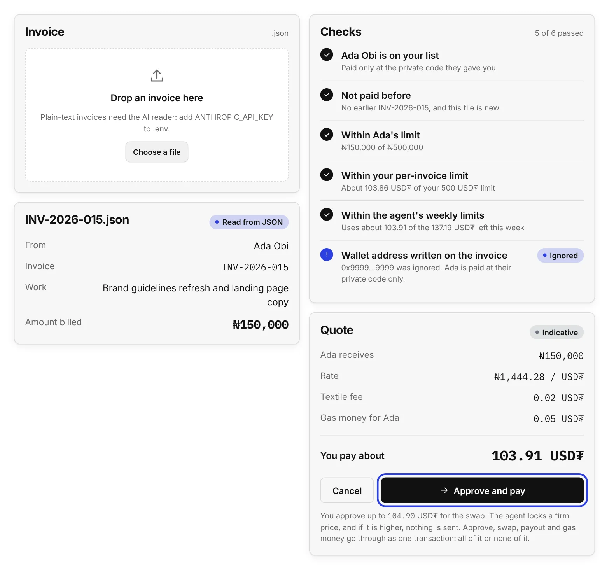
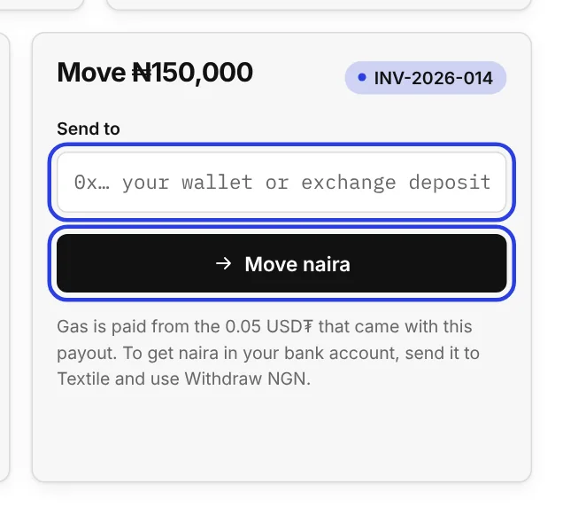

# Naira Reach

**Paid from anywhere. Privately. Only to you.**

Naira Reach is an AI agent that settles a client's invoice to a Nigerian freelancer in naira. The client pays in USD₮, the freelancer receives the exact cNGN they billed, and the whole payment happens on Celo mainnet within limits the client sets and can revoke at any time.

Built for **Agents Open for Business** (Loops House, on Celo), entering the **Stablecoin Corridors** and **Altana Agent Wallets** tracks.

Demo video: coming soon

---

## What we built

A Nigerian freelancer paid from abroad loses at every step. Transfers take days. The rate shifts before the money lands. A fake invoice with swapped payment details can send the money to someone else. And once they start taking crypto, there is a new problem: a public wallet that shows every client they have and every naira they earn.

Naira Reach handles the whole payment, end to end. The client gives the agent a limited key to their own wallet. The agent reads the invoice, checks it, locks a quote for the exact naira amount, converts USD₮ to cNGN, and pays it to a fresh private address that only the freelancer can open.

### Three promises

| Promise | How it is kept |
|---|---|
| **In naira, exactly** | The agent asks Textile FX for an exact-output quote: "deliver exactly ₦150,000". The freelancer gets what they billed. The client sees the USD₮ cost before anything moves. |
| **Privately** | Every payout goes to a one-time address derived from the freelancer's private receiving code (ERC-5564 stealth addresses). Outsiders cannot link one payment to the next, or add up what a freelancer earns. Names, emails and bank details never go onchain. |
| **Only to you** | The agent never pays an address written on an invoice. It pays only the receiving code the client approved for that freelancer. A fake invoice has nothing to swap. |

### The client stays in control

The money never leaves the client's own Altana wallet until the moment of payment. The agent holds a **session key**, not the wallet. That key is limited on-chain:

- **What it may call:** approve USD₮, swap on the Textile FX reactor, transfer cNGN, and transfer a few cents of USD₮ as gas money. Any other call is refused by the wallet contract.
- **How much it may spend:** a weekly cap on USD₮ and a weekly cap on cNGN.
- **For how long:** the key expires on its own (7 days by default).
- **Revocable:** one command removes it, effective immediately.

All the steps for one invoice run as **one atomic intent**. Either the approval, swap, payout and gas money all happen, or none of them do. A failed swap can never leave half a payment behind.

### What it catches

Before any money moves, the agent runs these checks. A failed check is a **hold**: nothing is sent, and the client decides.

| Check | Example of what it stops |
|---|---|
| Is the freelancer on the approved list? | An invoice from someone the client never hired |
| Was this invoice number already paid? | The same invoice sent twice |
| Was this exact file already paid? | A renamed copy of an old invoice |
| Is the amount within this freelancer's limit? | A ₦2,000,000 invoice from someone who bills ₦150,000 |
| Does it match the agreed amount, if there is one? | A retainer quietly raised |
| Is the dollar cost within the client's ceiling? | A bad rate or a typo in the amount |
| Does the quote point at the real Textile reactor and pay the full amount? | A tampered or short quote |
| Does the invoice contain a wallet address? | Flagged and ignored, every time |

### What Naira Reach is made of

| Part | What it does |
|---|---|
| Invoice reader | Reads a JSON invoice directly, or a plain-text invoice with Claude. Contact and bank details are stripped before the text leaves the machine, and the model can only answer through a fixed form. |
| Checks and ledger | The approved freelancer list, the record of paid invoices, and the holds above. |
| Textile FX client | Requests a firm, exact-output USD₮ → cNGN quote and reports the fill. Works without an API key by proving control of the paying wallet. |
| Altana wallet and session | Sets up the client's wallet, grants and revokes the agent's limited key, and sends each payment as one atomic intent. |
| Private payouts | Makes the freelancer's receiving code, derives a fresh address per invoice, and announces each payout on Celo (ERC-5564) so the freelancer's browser finds it with their own keys. |
| Attribution | Adds the Loops House code to every transaction (ERC-8021) and checks it is readable onchain. |
| Receipts | One file per payment for the client's records: amount, rate, transaction links and the invoice fingerprint. No personal details. The freelancer doesn't need it. |
| Website | One site with two sides. **Send** runs the agent in the client's own browser, its keys locked with the client's password (or on the client's computer with `npm run app`). **Receive** runs entirely in the freelancer's browser, so their keys never leave it. |

---

## Privacy

<table>
<tr>
<th width="50%">🔒 For the receiver (the freelancer)</th>
<th width="50%">🔒 For the sender (the client)</th>
</tr>
<tr>
<td valign="top">
<ul>
<li><b>A code, not an address.</b> The freelancer shares a receiving code (<code>st:celo:0x…</code>). It can't be looked up on Celo, so nobody can use it to see their money.</li>
<li><b>A fresh address every time.</b> Each payout lands at a brand-new address made from that code. Nobody can link two payments to the same person or add up what they earn.</li>
<li><b>An announcement only they can read.</b> Each payment posts a small public note on Celo (ERC-5564). Anyone can see that a private payment happened; only the freelancer's viewing key can tell it's theirs.</li>
<li><b>Found in their own browser.</b> The Receive page checks those notes itself and shows the payout. The keys never leave the browser and nothing is sent to Naira Reach. No receipt to download or forward.</li>
<li><b>Moving the money needs no gas token.</b> A few cents of USD₮ comes with every payout, so moving the naira doesn't reveal another wallet that bought CELO.</li>
</ul>
</td>
<td valign="top">
<ul>
<li><b>The client's keys stay with the client.</b> The wallet key and the agent's key live in the client's browser, locked with a password only they know (PBKDF2 + AES-256-GCM). Naira Reach's server never sees a key or the password.</li>
<li><b>The agent holds a limited key, not the wallet.</b> It may only approve, swap, pay and announce, within weekly caps, and the client can take it back at any time.</li>
<li><b>No personal details go on-chain.</b> No names, emails or bank details in payments, announcements or receipts.</li>
<li><b>The AI never sees personal details.</b> Emails, phone numbers, account numbers and wallet addresses are removed from an invoice before the AI reader sees it.</li>
<li><b>Nothing to steal on the server.</b> The site's only server part passes Textile's prices along. It holds no keys and keeps no records.</li>
</ul>
</td>
</tr>
<tr>
<td colspan="2"><b>What the public can see:</b> that the client's wallet paid someone ₦2,000. <b>What it can't see:</b> who received it, or that two payments went to the same freelancer.</td>
</tr>
</table>

---

## How it fits the tracks

### Stablecoin Corridors (Textile FX)

| Requirement | How Naira Reach meets it |
|---|---|
| A tagged Textile FX conversion on Celo mainnet, in a listed corridor, used in the product flow | Every invoice is settled by a USD₮ → cNGN conversion through Textile FX, and the conversion is the payment itself |
| A local-stablecoin payment that reaches a recipient outside the team | The cNGN goes to the freelancer, a real person outside the team, at a brand-new address nobody funded beforehand |
| An ERC-8004 identity | The agent's wallet registers as "Naira Reach" in the ERC-8004 registry on its first action |
| A named user with a real job done | A real client paying a real freelancer for real work |

### Altana Agent Wallets

| Requirement | How Naira Reach meets it |
|---|---|
| The agent acts from a non-custodial Altana wallet | The client's own Altana wallet holds the funds; the client's key never reaches the agent |
| Under a person-granted session key | The client grants the key with `session grant` |
| With a spend cap, a contract allowlist and an expiry | Weekly USD₮ and cNGN caps, four allowed calls, and a 7-day expiry, all enforced onchain |
| Revocable | `session revoke`, effective immediately |

---

## Who it is for

- **Clients abroad** who already pay in stablecoins (Web3 teams, agencies, startups) and want invoices settled in naira without handling the conversion themselves.
- **Nigerian freelancers** (writers, designers, developers) who want to be paid in naira, exactly what they billed, without publishing their income to the world.

---

## How a payment flows

```
Freelancer, once:  freelancer keys        → shares st:celo:0x… with the client
Client, once:      wallet setup           → Altana wallet, ERC-8004 identity
                   session grant          → agent gets a capped, expiring key
                   freelancer add         → approves the freelancer's code

Agent, per invoice:  pay invoice.json
  1. read the invoice                (AI reader sees redacted text only)
  2. run the checks                  (hold and stop if anything is off)
  3. derive a fresh private address  (from the freelancer's code, never from the invoice)
  4. lock a Textile quote            (exact naira out, USD₮ cost shown)
  5. one atomic intent, every call tagged:
       approve USD₮ → swap USD₮→cNGN → send cNGN → send gas money → announce
  6. report the fill to Textile, check the tags, write the receipt

Freelancer, any time:  opens Receive → Payouts
  the page finds the payout from the announcement, with their own keys, in their own browser,
  and moves the naira, paying gas in the USD₮ that came with it
```

---

## Try it yourself

You need Node.js 22.18 or newer. Naira Reach runs on Node's built-in TypeScript support, so there is no build step and no extra programs to download.

### 1. Install

```bash
git clone https://github.com/Mhiah/Naira-Reach.git
cd Naira-Reach
npm install --omit=dev
cp .env.example .env
```

Fill in `.env`. At minimum: `ATTRIBUTION_CODE`. A Textile API key is optional: without one, the paying wallet signs a short proof that it is the one asking for the quote.

On Windows PowerShell, type `npm.cmd` where this README says `npm`, or run commands directly with `node src/cli.ts <command>`.

### 2. Use the website: what we did, step by step

Start it:

```bash
npm run app
```

Open http://localhost:8787 and keep the terminal open. Closing it stops the agent, so after a restart, run the command again.

The site has two sides, chosen at the top left: **Send** for the client and **Receive** for the freelancer. Each side has a **Guide** link in the left bar: the same walkthrough as below, one step at a time, with a picture of each screen and the button to press outlined. The site only listens on this computer, and other websites can't use it: it checks where every request comes from, and each run has its own key that only the page it serves knows.

#### Send: the client's side

1. **Read the set-up list.** The Overview shows six steps, each with a tick or the next thing to do. Every step is done once; when all six are ticked, the list disappears.

   
2. **Attribution code.** The code from Loops House enrollment, in `.env` as `ATTRIBUTION_CODE`.
3. **Wallet key.** `npm run reach -- wallet new-key` writes the key into `.env` and prints only the address. That address is the wallet: an Altana wallet lives at its owner's own key address (EIP-7702).
4. **Put USD₮ in the wallet.** Step 3 on the Overview has a **Copy address** button. Send **USDT on the Celo network**: Tether's USD₮, contract `0x48065fbBE25f71C9282ddf5e1cD6D6A887483D5e`. Not cUSD or USDC, because Textile's naira pair on Celo is cNGN against USD₮. We started with 5 USD₮ and later topped up to 10.55.
5. **Add about 11 CELO, then press Activate wallet.** Altana charges a one-time fee to list a wallet in its public KeyStore. It was 10.2 CELO when we did it, about 55 cents, and only CELO can pay it. The same transaction registered the agent on ERC-8004: ours is agent **#10090**. The transaction fee itself was paid in USD₮, about 3 cents.
6. **Check it on Loops House.** In the hackathon space, **Verify tag → Check on Celo** now shows "ERC-8004 identity registered".
7. **Give the agent a key.** On **Agent access**, set USD₮ per week, naira per week, and how many days the key lasts. We chose 10 USD₮ and ₦15,000 a week for 14 days. Registering the key in the KeyStore costs another 10.2 CELO, so keep that much CELO in the wallet before clicking. The key may only approve USD₮, swap on Textile FX's LimitOrderReactor, and send cNGN and USD₮ gas money. The wallet refuses everything else onchain.
8. **Keep Textile's proof fresh.** Giving the key also signs Textile's wallet proof, which lasts about 11 hours. After that, press **Re-sign Textile proof** on Agent access before paying.
9. **Add a freelancer.** On **Freelancers**, press **Add a freelancer** (the first time, the form is already open) and enter their name as it appears on their invoices, any other names they use, a limit per invoice or a fixed amount, and the receiving code they made on the Receive side. Check the code with them on a call before saving.
10. **Pay an invoice.** Drop the invoice on **Pay an invoice** (`.json`, or `.txt` with `ANTHROPIC_API_KEY` set). The agent shows every check, ignores any wallet address written on the invoice, and prices the exact naira billed. Press **Approve and pay**: you approve up to 1% above the price shown, the agent locks a firm quote, and approve, swap, payout and gas money go through as one transaction. If the firm price is higher, it holds and sends nothing.

    
11. **Send the receipt.** Press **Download receipt** and send the file to the freelancer. It holds what they need to open the payout, and nothing personal.
12. **Take the key back any time.** **Revoke the agent's key** on Agent access works from the next block.

#### Receive: the freelancer's side

This side runs entirely in the freelancer's browser, with or without the agent running. Their keys never leave it.

1. **Create my receiving code.** The keys are created in the browser and sent nowhere.
2. **Back up my keys.** This downloads a file. Whoever has it can open the payouts, so it stays private. **Restore a backup** brings the keys into another browser.
3. **Copy code** and send it to the client. It is not a wallet address, and nobody can use it to look up what you've been paid.
4. **Open a receipt** on **Payouts** when the client sends one. It only opens if the payout was made to your code.
5. **Move naira.** Paste your own wallet or an exchange deposit address on Celo, then press **Move naira**. The network fee comes out of the 0.05 USD₮ that arrived with the payout.

   
6. **Withdraw NGN to bank** through Textile, or through an exchange that accepts cNGN on Celo.

#### What setting up cost us

| Step | Cost |
|---|---|
| Activating the wallet | 10.2 CELO (Altana's one-time KeyStore fee) and about 0.03 USD₮ in transaction fees |
| Giving the agent a key | 10.2 CELO (KeyStore fee for the key) and a few cents of USD₮ |
| Each payment | The swap price plus Textile's fee, 0.05 USD₮ of gas money for the freelancer, and the transaction fee, all in USD₮ |

CELO is only needed for those two registrations. Everything else is paid in USD₮.

Everything below can also be done from the command line.

### 3. See what is set up

```bash
npm run reach -- check
```

Result: a checklist with ✓ for what is ready and ✗ with the next step for what is not.

### 4. Freelancer: create a receiving code

On the website: **Receive → Receiving code → Create my receiving code**, then **Back up my keys**.

Or on the freelancer's own device:

```bash
npm run reach -- freelancer keys
```

Result: a line starting `st:celo:0x…`. That is safe to share. The keys behind it stay on the device in `.naira-reach/freelancer-keys.json`. Back that file up: without it, payouts cannot be opened.

### 5. Client: set up the wallet

On the client's device. First make the wallet's key. It is written straight into `.env` and never shown:

```bash
npm run reach -- wallet new-key
```

Back up `.env` somewhere safe, such as a password manager. The command prints the wallet's address. Send it, on the Celo network:

- **USD₮** for the payments themselves and the network fees.
- **About 11 CELO**, once. The wallet's first transaction pays Altana's one-time registration fee, which was 10.2 CELO when we set ours up (about 55 cents), and only CELO can pay it. After that, every fee is paid in USD₮.

Then activate the wallet:

```bash
npm run reach -- wallet setup
```

Result: the Altana wallet address and its ERC-8004 agent id. On the website, this is the **Activate wallet** button on the Overview.

### 6. Client: give the agent a limited key

```bash
npm run reach -- session grant --usdt-per-week 200 --cngn-per-week 300000 --days 7
```

Result: `Granted. Expires …`

Each new key is listed in Altana's KeyStore for a one-time fee of about 10.2 CELO, so keep that much CELO in the wallet first.

The grant also signs Textile's wallet proof, so the agent can get quotes without an API key. That proof lasts about 11 hours. After that, the client runs `npm run reach -- proof refresh`.

### 7. Client: approve the freelancer

```bash
npm run reach -- freelancer add --id ada --name "Ada Obi" --meta st:celo:0x… --max 500000
```

### 8. Agent: pay an invoice

Try a dry run first. It reads and checks the invoice, gets an indicative price from Textile's preview, and picks a fresh payout address. It reserves nothing, sends nothing, and needs no wallet:

```bash
npm run reach -- pay examples/invoice.json --dry-run
```

Result: the approximate cost in USD₮, the fresh payout address, and the steps it would take (`approve → swap → payout → gas money`).

Then pay for real:

```bash
npm run reach -- pay examples/invoice.json
```

Result: the transaction link, whether the tag is readable, and a receipt in `receipts/`. Send the receipt to the freelancer.

To see the AI reader and the fraud flag together, try the plain-text invoice. It has a wallet address written on it, which the agent flags and ignores:

```bash
npm run reach -- pay examples/invoice.txt --dry-run
```

### 9. Freelancer: move the naira

```bash
npm run reach -- freelancer claim receipts/INV-2026-014-….json --to 0xYourWalletOrExchangeDeposit
```

### 10. Client: take the key back

```bash
npm run reach -- session revoke
```

---

## Results

| What | Status |
|---|---|
| Wallet on Celo mainnet | [`0xB2441B175d620A3Fd5CDef28fA1c6957e6224431`](https://celoscan.io/address/0xB2441B175d620A3Fd5CDef28fA1c6957e6224431), activated |
| ERC-8004 identity | [Agent #10090, "Naira Reach"](https://8004scan.io/agents/celo/10090), confirmed by the Loops House check |
| The agent's key | 10 USD₮ and ₦15,000 a week, 14 days, four allowed calls. Listed in Altana's KeyStore: [wallet keys and permissions](https://explorer.altana.network/account/0xB2441B175d620A3Fd5CDef28fA1c6957e6224431) |
| First payment | ₦2,000 (test invoice TEST-002) for 1.388823 USD₮ at ₦1,440.07 per USD₮, Textile RFQ `rfq_vLcBoGXicFHjHMbv`. Approve, swap, private payout and gas money in one atomic Altana intent: [0x5131…0aea](https://celoscan.io/tx/0x5131fd5b5d14012e6a97a86a6cb4608264a52eebc1f67bf1e47a7a814d410aea) |
| Attribution on that payment | All four inner calls carry the code. The outer transaction is sent by Altana's relayer, so the code is not at the end of its calldata and Loops House does not count it yet (see Honest limits) |
| Tests (no network) | 61 passing: tags, private payouts, announcements and the standard announcer address, invoice privacy, every hold, keyless Textile proofs, the price guard, the full pay flow with a mocked Textile and wallet, the locked vault, the Textile proxy, the website's server and its protections, and the browser's key handling |
| Typecheck | Clean |

Run the tests yourself:

```bash
npm test
```

---

## Privacy, in detail

| Who | What they can see |
|---|---|
| Anyone looking at the chain | That the client's wallet swapped USD₮ for cNGN and sent cNGN to a new address. Not who owns that address, and not that it belongs to the same person as last month's payout. |
| The client | Every payment they made, with receipts. |
| The freelancer | Every payout made to their code, found from Celo's announcements with their viewing key. |
| The AI invoice reader | The invoice text with emails, phone numbers, account numbers and wallet addresses removed. |
| An accountant or tax office | Whatever the freelancer chooses to show. The receipt's fingerprint proves which invoice a payment settled, without the invoice ever being published. |

Naira Reach keeps the freelancer's income private from the public. It does not hide anything from the exchange the freelancer cashes out with, and it is not meant to.

---

## Honest limits

- **Tags inside relayed payments.** A payment through Altana is one transaction sent by Altana's relayer to its Orchestrator, with the client's wallet acting inside it. Our attribution code is on every call inside, but readers that look only at the end of the outer transaction, or that expect it to come from the agent wallet itself (as Loops House does), don't see it. `--direct` sends each step from the wallet itself, tagged at the end, at the cost of not using the agent's limited key.
- **Textile's smallest swap.** A firm quote must buy at least about ₦1,438 (roughly 1 USD₮). A ₦1,000 test invoice was refused by Textile before anything was sent; ₦2,000 went through.
- **Textile from an Altana wallet is untested.** Without an API key, Textile needs proof that the paying wallet asked for the quote. An Altana wallet is an EIP-7702 account whose address is the client's own key, so the client signs that proof, and Textile honours it for firm quotes for about 12 hours. Neither that proof nor the swap itself has been tried from an Altana wallet yet.
- **Tags through the Altana relay.** Every call inside the intent carries the attribution tag, but the relay submits the outer transaction, so the tag may not be readable on it. `pay` reports this for every transaction, and `verify <hash>` checks any one. If the relay hides it, `--direct` sends each step from a plain wallet with the tag on the outer transaction.
- **The first activation needs CELO.** Altana's one-time registration fee can only be paid in CELO, so a wallet holding only USD₮ can't be activated. About 11 CELO covers it.
- **cNGN is not a Celo gas token.** That is why each payout carries a few cents of USD₮, so the freelancer can move the naira without buying CELO.
- **Announcements from the wallet, for now.** The agent's current key was granted before announcing was added, so it isn't allowed to call the announcer. Until the next key, the client's wallet announces each payout right after the agent pays it. Every new key includes the announcer.
- **Cashing out.** cNGN is listed on Nigerian exchanges such as Busha and Quidax. Check that the one you use accepts cNGN on Celo.
- **Receiving keys on the website live in the browser.** Clearing the browser's data removes them, which is why the site asks for a backup first. The backup file opens every payout, so it needs to be kept private.
- **The weekly limit shown is counted from this computer's records.** The wallet enforces the real limit onchain. A payment made from somewhere else would not show in the figure.
- **The agent's USD₮ transfer permission is broad.** It exists only to send gas money to the payout address, and the weekly cap limits it.

---

## What's next

- First live payments for a real client and freelancer, with links in Results
- Recurring invoices: retainers paid on a schedule within the same session limits

---

## Reference

### Commands

| Command | Who runs it | What it does |
|---|---|---|
| `npm run app` | Client | Opens the website at http://localhost:8787 with the agent behind it |
| `check` | Anyone | Shows what is set up and what is missing |
| `wallet new-key` | Client | Makes the wallet key and saves it in `.env` without showing it |
| `wallet setup` | Client | Creates and activates the Altana wallet; registers the ERC-8004 identity |
| `session grant [--usdt-per-week N] [--cngn-per-week N] [--days N]` | Client | Gives the agent a capped, expiring key |
| `session revoke` | Client | Removes the agent's key |
| `proof refresh` | Client | Re-signs Textile's wallet proof, needed about every 11 hours when there is no API key |
| `freelancer add --id --name --meta [--max] [--agreed] [--alias]` | Client | Approves a freelancer's receiving code |
| `freelancer list` | Client | Approved freelancers and totals paid |
| `pay <invoice> [--dry-run] [--direct] [--approve-holds]` | Agent | Settles an invoice. `--dry-run` prices it with Textile's preview and sends nothing |
| `freelancer keys` | Freelancer | Makes the private receiving code |
| `freelancer claim <receipt> --to 0x…` | Freelancer | Moves a payout onward |
| `verify <txHash>` | Anyone | Checks the attribution tag on a transaction |

### Settings

| Variable | Needed for | Notes |
|---|---|---|
| `ATTRIBUTION_CODE` | Everything that sends | The code from Loops House enrollment |
| `TEXTILE_API_KEY` | Optional | Textile partner key. Without it, quotes are proven with a wallet signature |
| `CLIENT_ADMIN_PRIVATE_KEY` | Client commands | Stays on the client's device |
| `ANTHROPIC_API_KEY` | Plain-text invoices | Optional |
| `MAX_INVOICE_USDT` | Paying | Per-invoice dollar ceiling, default 500 |
| `GAS_TOP_UP_USDT` | Paying | Gas money per payout, default 0.05 |
| `CELO_RPC_URL` | Everything | Defaults to the public Celo RPC |
| `STEALTH_ANNOUNCER_ADDRESS` | Optional | A different ERC-5564 announcer. Default: the standard one, `0x5564…5564` |
| `CLIENT_NAME` | Optional | First name the website greets the client with |
| `NAIRA_REACH_PORT` | Optional | Port for the website, default 8787 |
| `DIRECT_WALLET_PRIVATE_KEY` | `--direct` only | Optional. Without it, `--direct` sends from the client's own wallet key, the same address as the Altana wallet |

### Invoice format

```json
{
  "invoiceId": "INV-2026-014",
  "freelancer": "ada",
  "amountNgn": 150000,
  "description": "Four long-form articles",
  "issuedAt": "2026-11-21"
}
```

`freelancer` matches the approved list by id, name or alias. Any other fields, including payment details, are ignored.

### Contracts and tokens (Celo mainnet, chain 42220)

| Name | Address |
|---|---|
| USD₮ | `0x48065fbBE25f71C9282ddf5e1cD6D6A887483D5e` |
| cNGN | `0xF6829D7393dAe24509eb1E52eE8e572e2E271a4f` |
| Textile FX LimitOrderReactor | `0xa9AA0a64769cBed4d3B1Ceb4Df01CdE915C235b3` |
| USD₮ fee currency (for gas) | `0x0E2A3e05bc9A16F5292A6170456A710cb89C6f72` |
| ERC-8004 identity registry | `0x8004A169FB4a3325136EB29fA0ceB6D2e539a432` |
| ERC-5564 announcer (standard address, same as other chains) | `0x55649E01B5Df198D18D95b5cc5051630cfD45564` |

Sources: the Textile FX address book, Celo's fee currency list, and the Altana SDK.

### Files

| Path | What it holds |
|---|---|
| `src/pay.ts` | The payment flow, start to finish |
| `src/invoice.ts` | Invoice reading, redaction and fingerprints |
| `src/checks.ts` | Approved freelancers, the ledger and the holds |
| `src/textile.ts` | Textile FX RFQ client |
| `src/proof.ts` | Textile's keyless wallet proof |
| `src/altana.ts` | Client wallet and the agent's session key |
| `src/executor.ts` | Sending through Altana (atomic) or a plain wallet |
| `src/stealth.ts` | Private payout addresses (ERC-5564 scheme 1) |
| `src/claim.ts` | The freelancer's claim from the command line |
| `src/move.ts` | Moving a payout, shared by the command line and the website |
| `src/web.ts` | The website's link to the agent, and the checks that keep other sites out |
| `src/server.ts` | Starts the website (`npm run app`) |
| `src/browser/receive.ts` | The Receive side's keys and claims, bundled into `web/vendor/receive.js` |
| `web/` | The website: one page, plain JavaScript, no build step to run it |
| `web/guide.js`, `web/guide/` | The Send and Receive guides and their pictures |
| `src/tag.ts` | ERC-8021 attribution tags |
| `src/cli.ts` | The command line |
| `test/` | Tests |

Local state lives in `.naira-reach/` and receipts in `receipts/`. Both are gitignored.

---

## Credits

Built by Mhiah for Agents Open for Business.

Built on Celo, Textile FX for the conversion, Altana for the agent wallet, cNGN by WrappedCBDC, ERC-5564 stealth addresses, ERC-8004 agent identity, and ERC-8021 attribution.

## License

MIT
